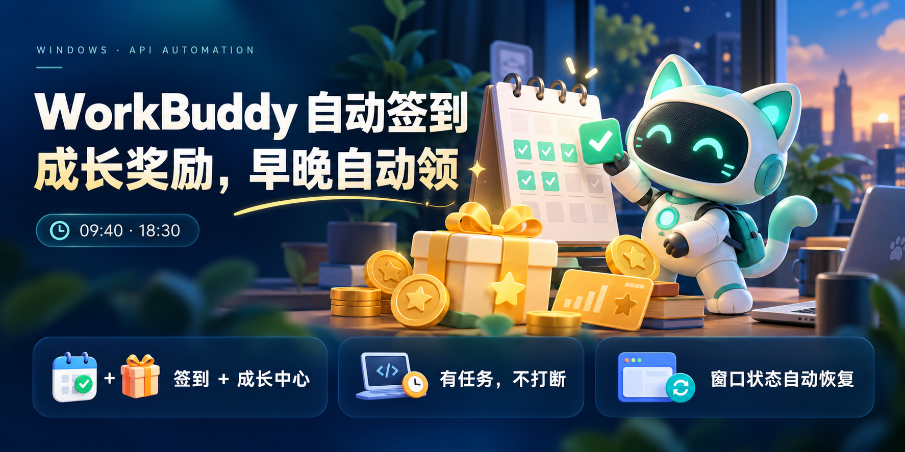
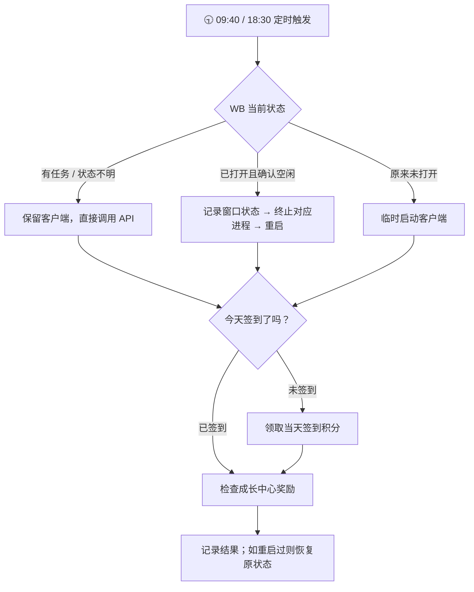

<div align="center">

# 🐾 WorkBuddy 自动签到与成长中心领奖

**每天两次，自动检查签到和成长奖励。少一点手动操作，多一点及时领取。**


[](LICENSE)

[🚀 快速开始](#-三步开始使用) · [🎁 能领什么](#-它能帮你做什么) · [🛠️ 常见问题](#️-常见问题)

</div>

> 打开电脑后，让系统定时检查 WB 奖励：**未签到就签到，已签到就继续检查成长中心。**
> 有工作任务在跑时，不重启客户端，直接调用 API。

## ✨ 为什么用它？

- 🎁 **签到和成长中心一起处理**：旅行礼物、任务奖、连登兑换等，符合接口条件时自动操作。
- 🕤 **早晚各检查一次**：默认每天 **09:40、18:30**，下午已经签过就不重复领签到积分。
- 🖱️ **领取过程不点鼠标**：通过 API 执行，不依赖图片识别、界面主题或按钮坐标。
- 🧑‍💻 **避让正在运行的任务**：任务活跃或状态不明时，保留客户端，直接走 API。
- 🪟 **记住原来的窗口状态**：空闲时重启签到，结束后恢复最小化、普通或最大化状态；原来没开，就在结束后清理本次启动的进程。
- 💤 **系统静默运行**：Windows 计划任务直接执行脚本，无需 AI 模型参与定时运行。

## 🎁 它能帮你做什么？

- **每日签到**：先查当天状态，未领取才提交领取。
- **Buddy 旅行**：领取已到达的旅行礼物，并在符合名额条件时派 Buddy 出发。
- **成长任务**：接受可接任务，领取已完成任务的奖励。
- **断登补登**：有补登卡且日期符合规则时使用，每轮最多一张。
- **连登兑换**：尝试兑换已解锁的连登档位奖励。
- **抽奖与 Buddy 盲盒**：使用已有抽奖机会或能量执行对应操作。

> [!NOTE]
> 这不是“自动完成工作任务”：需要实际使用 WB 才能完成的条件，仍需你自己完成。
> 补登修复的是成长中心的连登记录，**不代表补发过去漏领的每日签到积分**。
> 成长流程可能使用账户已有的补登卡、抽奖机会和能量；不包含购买积分或付费权益的流程。

## 🔄 一次领取是怎样进行的？



两次检查都运行完整流程。**每天两次不等于全天实时监控**，奖励能否跨天领取，以 WB 各项活动规则为准。

## 🚀 三步开始使用

### 1. 准备好环境

- Windows 10 / 11，安装 **Python 3.11 或更新版本**，建议保留安装器自带的 `py` 启动器。
- 安装并登录你自己的 WorkBuddy 账号。
- 当前进程管理默认使用安装位置：`%LOCALAPPDATA%\Programs\WorkBuddy\WorkBuddy.exe`。

### 2. 下载并放好文件夹

点击本页 **Code → Download ZIP**，解压到一个长期保留、当前用户可写的文件夹。

也可以用 Git：

```powershell
git clone https://github.com/funun3-hue/workbuddy-auto-checkin.git
cd workbuddy-auto-checkin
```

### 3. 双击安装

双击文件夹中的 **`install.cmd`**，看到时间为 `09:40, 18:30` 的验证成功提示后，定时配置完成。

安装只执行离线自检、注册计划任务和登录时修复入口，**不会立即发起领取**。只复制技能文件夹不会安装计划任务。

> [!TIP]
> 也可以把仓库链接发给你的 AI 助手：
>
> “请读取这个仓库的 README，检查本机 Python 和 WB 安装情况，然后安装默认 09:40、18:30 的签到及成长中心定时任务，不要立即领取：https://github.com/funun3-hue/workbuddy-auto-checkin”

## ⏰ 修改领取时间

在项目文件夹内打开 PowerShell，指定 Python 路径及两个时间：

```powershell
.\install-windows.ps1 -PythonPath 'C:\path\to\python.exe' -Time @('09:40','18:30')
```

把示例路径替换为你的实际 `python.exe` 路径，旁边需要有 `pythonw.exe`。

- 时间使用 **Windows 本机时区**；要按北京时间运行，请将系统时区设置为 `Asia/Shanghai`。
- 任务名为 **`WorkBuddy Daily Check-in`**，仅在当前用户登录 Windows 时运行。
- 电脑需要开机、保持唤醒并能联网；错过触发后会在可用时尝试补跑，不能保证跨天补领。
- 安装会在当前用户的“启动”文件夹添加修复入口，登录时检查并恢复丢失、禁用或配置不匹配的任务。
- 移动项目文件夹后，请重新安装。修复功能无法覆盖阻止计划任务的系统策略。

## 🧪 手动运行与查看结果

在项目目录运行：

```powershell
# 离线自检：不读取登录凭据，不联网
py -3.11 .\run_daily_claim.py --self-test

# 只查询每日签到状态：联网，但不领取
py -3.11 .\signin.py status

# 实际签到 + 成长中心，按任务状态处理重启与窗口恢复
py -3.11 .\run_daily_claim.py

# 实际签到 + 成长中心，直接走 API，不管理客户端窗口
py -3.11 .\run_daily_claim.py --api-only
```

结果保存在项目文件夹：

- **`signin.log`**：API 领取结果，包含签到及成长中心的分别汇报。
- **`WorkBuddy.log`**：是否重启、是否避让任务、窗口状态恢复等记录。
- **`schedule-repair.log`**：登录时的计划任务修复记录。

签到显示 `CLAIMED` 表示已领取，`ALREADY` 表示当天已签；还需看成长中心结果，**签到成功不等于每项成长奖励都领取成功**。遇到 `UNKNOWN`、认证失败或超时，应查看具体报告，不能当作成功。

<details>
<summary>🧩 开发者：运行离线测试</summary>

```powershell
py -3.11 -m unittest discover -s tests -q
```

当前版本已通过 72 项离线测试，覆盖认证、成长流程、运行时发现和入口路由等。测试样例为合成数据，不包含真实账号凭据。离线测试通过不代表线上活动可用，也不代表已实际收到奖励。

</details>

## 🛠️ 常见问题

**安装时找不到 Python？** 先安装 Python 3.11+，或按上面的命令用 `-PythonPath` 指定完整路径。

**WB 有任务在跑，会被关掉吗？** 检测到任务活跃或无法确认状态时，直接执行 API，保留现有客户端。确认空闲时才强制结束对应安装目录中的进程，再重新启动。

**18:30 已经签过了怎么办？** 跳过每日签到领取，继续检查成长中心，不会因此跳过整轮。

**没有领到奖励？** 先查看 `signin.log`。奖励可能尚未满足条件、已领过、活动未开放，也可能是接口或网络出错；以实际返回为准。

**提示认证或加密格式错误？** 检查客户端登录状态、版本和脚本兼容性。不修改凭据权限，不把格式不兼容简单归因于“重新登录就能解决”。

**支持 macOS、Linux 或 Qoder 吗？** 本仓库的完整安装和窗口管理流程面向 Windows WorkBuddy，目前不提供这些平台或 Qoder 的定时方案。

## 🧹 不想用了，怎么取消？

1. 在 Windows“任务计划程序”中删除 **`WorkBuddy Daily Check-in`**。
2. 按 `Win + R`，输入 `shell:startup`，删除 **`WorkBuddy API Check-in Repair.vbs`**。

两个都删除，避免下次登录时修复入口重新创建任务。

## 🔐 隐私与使用范围

只使用你自己授权的本机登录态。脚本文件不内置你的账号凭据，认证信息在本机处理，用于访问对应服务接口。

不要分享生成的日志、`schedule.local.json`、WB 登录文件或客户端数据库。完整的进程管理依赖已放在仓库内，无需复制作者电脑上的 AppData 脚本。

> [!IMPORTANT]
> 本项目是非官方工具，与 WorkBuddy 或腾讯无隶属关系。API 和加密凭据格式来自上游对客户端的分析，可能随客户端或服务端升级而变化。完整重启领取流程尚未在所有电脑和客户端版本上验证，请以日志中的实际结果为准。

## 🙏 来源与许可

API 签到、成长中心核心及部分测试基于 **[88lin/workbuddy-auto-signin](https://github.com/88lin/workbuddy-auto-signin)**，感谢原作者的实现与维护。本项目增加了面向本机使用的双时段安装、任务避让、进程重启及窗口恢复流程。

本项目使用 [MIT License](LICENSE)，上游 MIT 许可保留于 [UPSTREAM-LICENSE](UPSTREAM-LICENSE)。

如果这个版本帮你减少了手动操作，欢迎点个 ⭐，也方便之后找回来查看更新。
